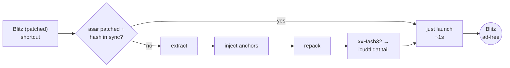

<div align="center">

```
 ____  _     ___ _____ _____ 
| __ )| |   |_ _|_   _|__  / 
|  _ \| |    | |  | |   / /  
| |_) | |___ | |  | |  / /_  
|____/|_____|___| |_| /____| 
                            
      A D - B L O C K
```

**The Blitz.gg desktop app — minus the ads, minus the empty ad boxes, minus the tracking.**

Patches Blitz's Electron shell in place. No proxy, no launcher daemon, no admin, no Node.js required.

[](LICENSE)
[](https://www.microsoft.com/windows)
[](https://github.com/PowerShell/PowerShell)
[](https://blitz.gg)
[](https://github.com/ATSDopi/blitz-adblock/stargazers)

[Install](#-install--30-seconds) · [How it works](#-how-it-works) · [CLI](#%EF%B8%8F-cli-reference) · [Uninstall](#-uninstall) · [Français](#-français)

</div>

---

## ✨ What you get

| | Feature | Detail |
|---|---|---|
| 🚫 | **Network ad-blocking** | [@ghostery/adblocker](https://github.com/ghostery/adblocker) engine on `session.webRequest` — EasyList, EasyPrivacy, uBlock filters, Peter Lowe's list. Ad requests never leave the app. |
| 🧹 | **Cosmetic cleanup** | Blitz's ad slots literally carry 🤑 class names (`🤑-wrapper`, `🤑-sidebar`, `🤑-rectangle`). A `<style>` + `MutationObserver` + inline `display:none !important` removes them — *and* `.advertisement`, `.promotion`, Primis video slots, the Quantcast consent banner, premium upsells. |
| 📐 | **Layout reclaimed** | `--right-rail-width: 0px` collapses the ad column — the app content takes back the full width instead of leaving dead space. |
| 🎮 | **Deadlock fixes** | Normalizes `deadlock.exe` path matching (upstream `path not found` bug) + retries offsets fetch on transient CDN 403s. Harmless if you don't play. |
| 🎨 | **User hooks** | `user.css` / `user.js` in `%APPDATA%\Blitz\` → injected on every page load. Free theming. |
| ♻️ | **Survives updates** | Blitz updates reinstall the whole program folder → the **"Blitz (patched)"** shortcut verifies the patch state at every launch and silently re-applies it. |

---

## 🚀 Install — 30 seconds

```
1.  Download this repo        (Code → Download ZIP → extract anywhere)
2.  Double-click              patch-blitz.bat
3.  Use the new shortcut      "Blitz (patched)"  on your Desktop
```

That's it. The installer auto-detects your Blitz folder (default path → uninstall registry keys → asks you if really lost), patches `app.asar`, self-installs a repair kit in `%APPDATA%\Blitz\patch-kit`, creates the shortcut, and launches Blitz.

> **No Node.js?** The patcher uses `Blitz.exe` itself as the runtime (`ELECTRON_RUN_AS_NODE=1`). Truly zero dependencies.

Prefer the terminal?

```powershell
powershell -ExecutionPolicy Bypass -File .\blitz-patch.ps1 -Install
```

---

## ♻️ Why the shortcut matters

Blitz's auto-updater doesn't patch files — it **reinstalls the entire `Programs\Blitz` directory** (timestamps preserved, so it looks untouched). Every update silently reverts `app.asar` *and* `icudtl.dat`.

The **"Blitz (patched)"** shortcut runs `blitz-patch.ps1 -Auto -Launch` on every launch:



Re-patch costs a few seconds; if nothing changed it adds ~1s. Either way you always boot clean.

<details>
<summary><b>🔬 How it works</b> — the technical deep dive</summary>

<br>

Blitz's UI is a remote web app (`blitzapp.gg/vX.Y.Z/…`) rendered inside a `BrowserView`; the local `app.asar` is just the Electron shell + native handlers. So all hooking happens in the **main process**:

1. **Extract** `resources\app.asar` with the vendored `asar` npm package.
2. **Patch `src\electronWindowHandlers.js`** on a stable anchor — `function interceptRequests(window) {`, invoked once per window:
   - *Head block* (before the function): the `FiltersEngine` loader + cosmetic CSS constants.
   - *Body block* (inside it): the `webRequest.onBeforeRequest` hook + `attachCosmetics`, which waits for `window.browserView` (present only on the main app window — the in-game OSR overlay is left alone), then binds injection to `dom-ready` / `did-navigate` / `did-frame-finish-load` + retries.
3. **Patch `src\gameHandlers\deadlock\index.js`** — path normalization + offsets retry (anchor-verified, skipped gracefully if upstream code changes).
4. **Copy the payload** (engine + 5 filter lists) into `src\`, repack preserving `unpacked` entries (`*.node`, `lzma-native`), and sync `resources\app.asar.unpacked\`.
5. **Defeat `VerifyApp`** — Blitz's bootstrap computes `xxHash32(app.asar)` and compares it against a `uint32` in the **last 4 bytes of `icudtl.dat`**. Mismatch → `E6` in `crash.log`, app exits. We recompute the hash with an inline C# `Add-Type` class and rewrite those 4 bytes.
6. Back up untouched originals once → `app.asar.orig` / `icudtl.dat.orig`.

If an anchor fails to match a future Blitz build, the script **warns and aborts that file** rather than writing a broken patch.

> Why `<style>` DOM injection instead of `webContents.insertCSS()`? The page CSP swallows injected author sheets; a DOM element survives it. Why inline `display:none !important` *in addition*? Blitz's own `!important` rules have higher specificity than attribute selectors — inline always wins. Why the `MutationObserver`? It's a SPA — slots get re-rendered, we re-hide them.

</details>

<details>
<summary><b>🎨 user.css / user.js — free theming</b></summary>

<br>

Two optional files, re-read on every page load (no repack needed):

| File | Location | Injected as |
|---|---|---|
| `user.css` | `%APPDATA%\Blitz\user.css` | `<style id="blitz-user-css">` |
| `user.js` | `%APPDATA%\Blitz\user.js` | `executeJavaScript` (sandboxed try/catch) |

Example — hide the scrollbar & tint the header:

```css
::-webkit-scrollbar { width: 6px; }
::-webkit-scrollbar-thumb { background: #8a2be2; border-radius: 3px; }
```

</details>

---

## ⚙️ CLI reference

`blitz-patch.ps1` accepts:

| Flag | Effect |
|---|---|
| `-Install` | Full first-run: detect → self-install kit → patch → create shortcuts → launch |
| `-Auto -Launch` | Shortcut mode: check state → re-patch if needed → launch → verify |
| `-Check` | Report patch/hash state only (`exit 0` ok, `exit 2` needs re-patch) |
| `-Force` | Re-patch even if everything looks fine |
| `-BlitzDir "…"` | Explicit install dir (skips auto-detection, saved for next runs) |
| `-NoLaunch` | Don't start Blitz at the end |

Manual re-patch after an update (if you launched Blitz without the shortcut):

```powershell
powershell -ExecutionPolicy Bypass -File "$env:APPDATA\Blitz\patch-kit\blitz-patch.ps1" -Force -Launch
```

## 📁 What lands on your disk

```
%LOCALAPPDATA%\Programs\Blitz\
├── resources\app.asar            ← patched (adblock + cosmetics + deadlock)
├── resources\app.asar.orig       ← pristine backup (first patch only)
├── resources\app.asar.unpacked\  ← re-synced native modules
└── icudtl.dat                    ← last 4 bytes = xxHash32(app.asar)
    icudtl.dat.orig               ← pristine backup

%APPDATA%\Blitz\
├── patch-kit\                    ← self-installed copy of this repo
│   ├── blitz-patch.ps1  patch-blitz.bat  payload\  node_modules\
│   └── install-dir.txt           ← remembered Blitz path
├── user.css / user.js            ← optional, your own
└── app.log                       ← "[core] ADBLOCK BLOCKED: …" trail

Desktop + Start Menu\
└── Blitz (patched).lnk           ← -Auto -Launch (powershell, hidden)
```

## 🗑️ Uninstall

```powershell
cd "$env:LOCALAPPDATA\Programs\Blitz"
Copy-Item resources\app.asar.orig resources\app.asar -Force
Copy-Item icudtl.dat.orig icudtl.dat -Force
Remove-Item "$env:APPDATA\Blitz\patch-kit" -Recurse -Force
# then delete "Blitz (patched).lnk" on Desktop + Start Menu
```

## ❓ FAQ

<details>
<summary><b>Does it remove premium features / unlock anything?</b></summary>

No. It blocks ad *delivery* and hides the empty containers. Premium is server-side — untouched (and out of scope).
</details>

<details>
<summary><b>Will I get banned?</b></summary>

It modifies local app files, not the game, not Blitz's servers. Same category as the widely-used Spotify patchers (BlockTheSpot/SpotX). That said — no affiliation with Blitz, use at your own discretion.
</details>

<details>
<summary><b>A Blitz update broke something?</b></summary>

Launch via the shortcut — it re-patches automatically. If Blitz changed the code anchors, the script warns instead of corrupting anything; open an issue with `%APPDATA%\Blitz\app.log` and your Blitz version.
</details>

## ⚖️ Disclaimer & credits

For personal use on your own installation. This repo ships **patches only** — no Blitz binaries, no extracted sources. If you're a Blitz dev and want something changed/removed, open an issue.

Built on the shoulders of:

- [@ghostery/adblocker](https://github.com/ghostery/adblocker) — MPL-2.0
- [electron/asar](https://github.com/electron/asar) — MIT
- [EasyList](https://easylist.to/) / EasyPrivacy — GPLv3 / CC-BY-SA
- [uBlock Origin](https://github.com/gorhill/uBlock) filters — GPLv3
- [Peter Lowe's ad server list](https://pgl.yoyo.org/adservers/) — free for non-commercial use
- Selector intel: [cleanse-for-blitz](https://github.com/rojnwa/cleanse-for-blitz), [Il-Mazu/blitz-ad-blocker](https://github.com/Il-Mazu/blitz-ad-blocker)

---

<div align="center">

# 🇫🇷 Français

**Blitz sans pubs, sans les encarts vides, sans le tracking — et qui survit aux mises à jour.**

</div>

### Installation

```
1. Télécharge le repo   (Code → Download ZIP → extrais où tu veux)
2. Double-clique        patch-blitz.bat
3. Lance Blitz via      le raccourci "Blitz (patched)" sur ton Bureau
```

L'installeur détecte Blitz tout seul (chemin par défaut → registre → te demande sinon), patche `app.asar`, installe le kit dans `%APPDATA%\Blitz\patch-kit`, crée le raccourci, lance Blitz. **Pas de Node requis** — `Blitz.exe` sert de runtime.

### Pourquoi le raccourci

Chaque update Blitz **réinstalle tout le dossier** → le patch saute. Le raccourci vérifie `xxHash32(app.asar)` vs le hash stocké dans `icudtl.dat` à chaque lancement et **repatche tout seul** (~1 s si rien à faire). Utilise-le systématiquement.

### Sous le capot

- `session.webRequest` + moteur @ghostery/adblocker (5 listes) → les pubs ne partent jamais
- Slots pubs `🤑-*`, `.advertisement`, `.promotion`, vidéos Primis, bandeau Quantcast → `<style>` + MutationObserver + `display:none !important` inline → colonne droite repliée (`--right-rail-width: 0px`)
- `VerifyApp` compare `xxHash32(app.asar)` aux 4 derniers octets d'`icudtl.dat` → recalculé en C# inline après repack
- Bonus : fixes Deadlock (chemin `deadlock.exe`, retry 403 offsets) + hooks `user.css`/`user.js`

### Désinstallation

```powershell
cd "$env:LOCALAPPDATA\Programs\Blitz"
Copy-Item resources\app.asar.orig resources\app.asar -Force
Copy-Item icudtl.dat.orig icudtl.dat -Force
Remove-Item "$env:APPDATA\Blitz\patch-kit" -Recurse -Force
# + supprimer les raccourcis "Blitz (patched)"
```

---

<div align="center">
<sub>Made with 🧊 for a cleaner Blitz — MIT © 2026</sub>
</div>
